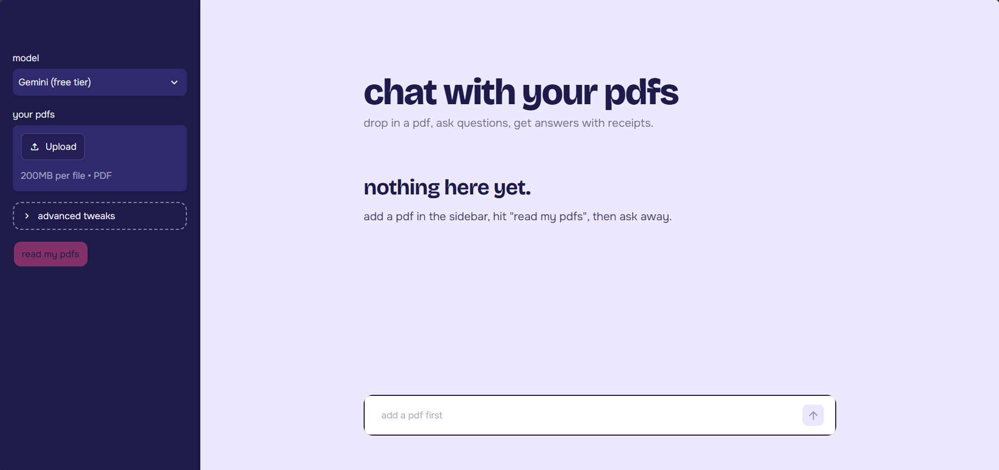
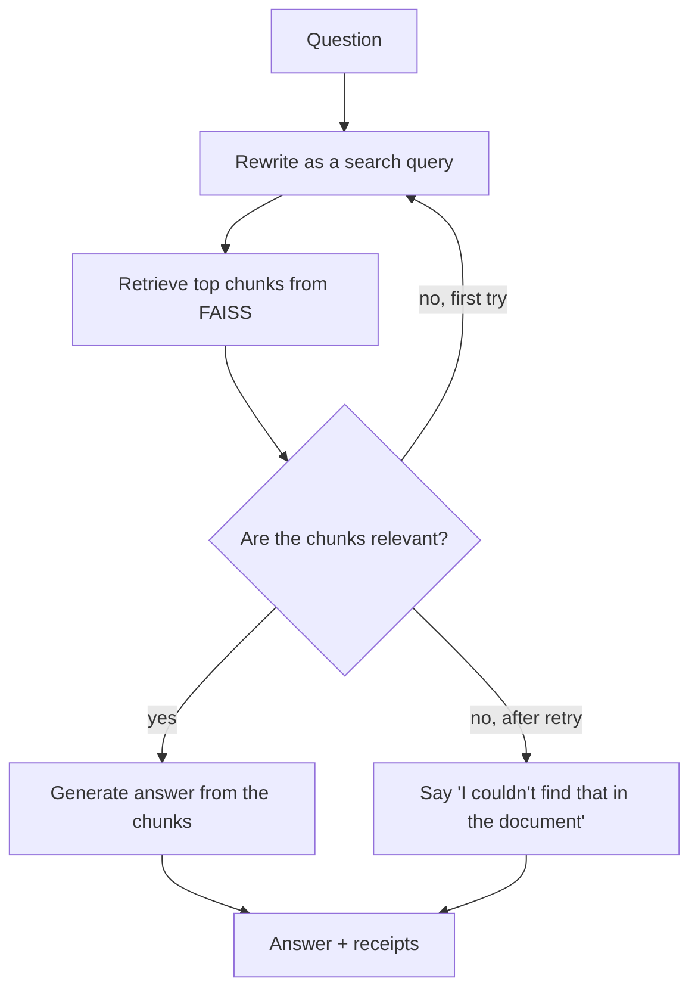

# Chat with your PDFs

An agentic RAG app that answers questions from your PDFs and shows where each answer came from.
Instead of searching once and hoping for the best, a LangGraph agent rewrites the question, checks its own search results, and retries or says "not found" rather than making something up.



**Stack:** Python, LangChain, LangGraph, Hugging Face Embeddings, FAISS, Google Gemini, Streamlit

## What it does

- Upload one or more PDFs and ask questions in plain language
- Every answer comes with **receipts**: the pages and text chunks it was based on
- Understands follow-ups like "how does it work?" by reading the recent chat
- Declines to answer when the PDF doesn't contain the answer
- Shows **how i got this**, a step-by-step trace of what the agent did

## How it works



1. **Ingest:** PDFs are split into overlapping chunks and embedded with `all-MiniLM-L6-v2`, then stored in a local FAISS index.
2. **Rewrite:** the agent turns the question into a standalone search query, using chat history to resolve words like "it" or "that".
3. **Retrieve and grade:** it fetches the closest chunks, then asks the model whether they actually answer the question.
4. **Retry or decline:** if not, it writes a different query and tries once more. If that fails too, it declines instead of guessing.
5. **Answer:** otherwise it answers using only the retrieved text.

## Tech

| Part | Tool |
|---|---|
| Agent workflow | LangGraph |
| LLM | Google Gemini (free tier) via `langchain-google-genai` |
| Embeddings | Hugging Face `sentence-transformers/all-MiniLM-L6-v2` (runs locally) |
| Vector store | FAISS |
| PDF loading and chunking | LangChain (`PyPDFLoader`, `RecursiveCharacterTextSplitter`) |
| UI | Streamlit with custom CSS |

## Run it locally

You need Python 3.10+ and a free Gemini API key from [Google AI Studio](https://aistudio.google.com/apikey).

```bash
git clone https://github.com/vaishbil/chat-with-your-pdf.git
cd chat-with-your-pdf

python -m venv venv
venv\Scripts\activate          # Windows
source venv/bin/activate       # Mac/Linux

pip install -r requirements.txt
```

Then start the app:

```bash
streamlit run app.py
```

The first run downloads the embedding model (about 90 MB), so the first PDF takes a bit longer.

## Evaluation

`eval.py` runs a set of test questions against a PDF and checks each answer for an expected keyword.

```bash
python eval.py path/to/paper.pdf
```

I tested it on the original [RAG paper](https://arxiv.org/abs/2005.11401) with 10 questions in `eval_questions.csv`, including 2 that the paper can't answer.

| Version | Score |
|---|---|
| Baseline pipeline (retrieve, then answer; no agent) | 9/10 |

Both out-of-document questions were correctly refused. The one miss was a keyword that was too strict: the answer was right but used different words. The check is deliberately simple, so treat it as a sanity check, not a benchmark.

## Project structure

```
app.py               Streamlit UI and PDF indexing
rag_graph.py         LangGraph agent (rewrite, retrieve, grade, answer or decline)
eval.py              Evaluation script
eval_questions.csv   Test questions and expected keywords
.streamlit/          Theme colors
requirements.txt     Python dependencies
```

## Limitations

- Works on text PDFs only. Scanned or image-only PDFs have no text to read.
- The relevance check is done by the same model that answers, so it can occasionally be wrong in either direction.
- The index lives in memory, so it resets when the app restarts.
- Gemini's free tier has rate limits and sometimes gets busy.

## Ideas for next

- Run the evaluation on the full agent and compare it against the baseline
- Support scanned PDFs with OCR
- Save the index to disk so documents persist between sessions
